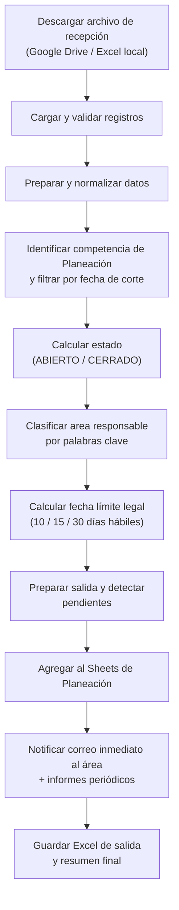
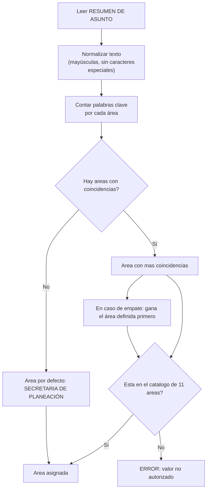
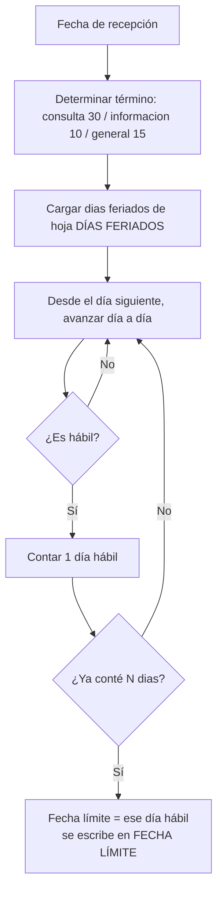
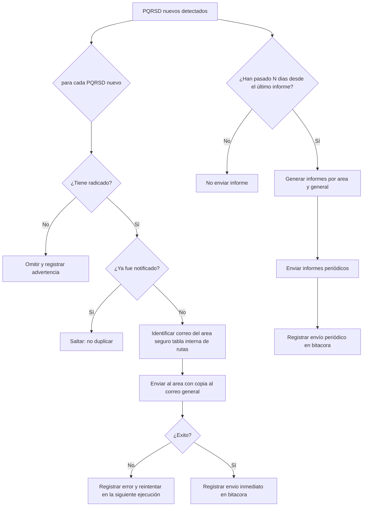
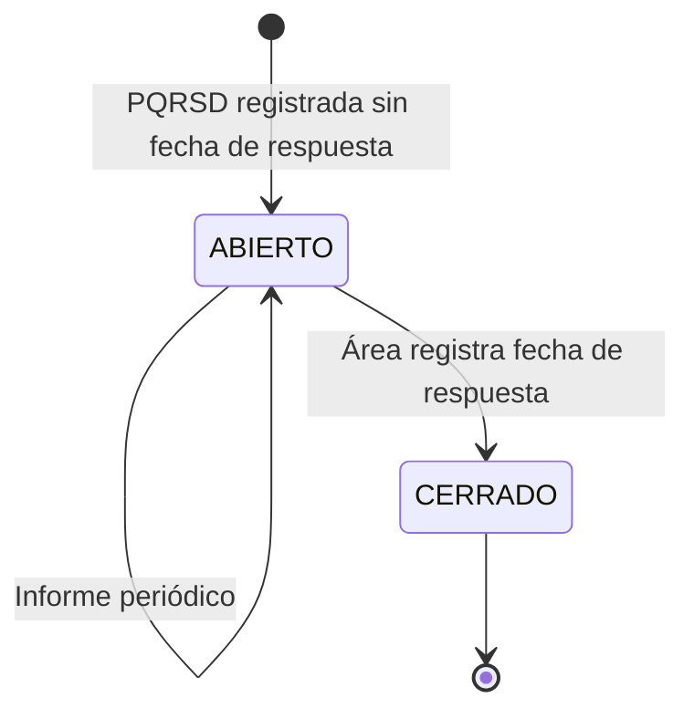

# Diagramas de Flujo — Sistema de Automatización PQRSD

**Entidad:** Alcaldía de Yondó, Antioquia
**Formato:** [Mermaid](https://mermaid.js.org/) — visible en GitHub, GitLab, VS Code (con extensión) y Typora.

---

## 1. Diagrama general del flujo

---

## 2. Diagrama del algoritmo de clasificación

Cómo se decide el área de una PQRSD a partir del *RESUMEN DE ASUNTO*:

**Reglas de negocio:**
- Gana el área con más palabras clave coincidentes; en empate prevalece el
  orden del catálogo; sin coincidencia → SECRETARIA DE PLANEACIÓN.

---

## 3. Diagrama del cálculo de fecha límite

---

## 4. Diagrama del flujo de correos

Notificación inmediata vs. informe periódico:

---

## 5. Diagrama de estados de una PQRSD

